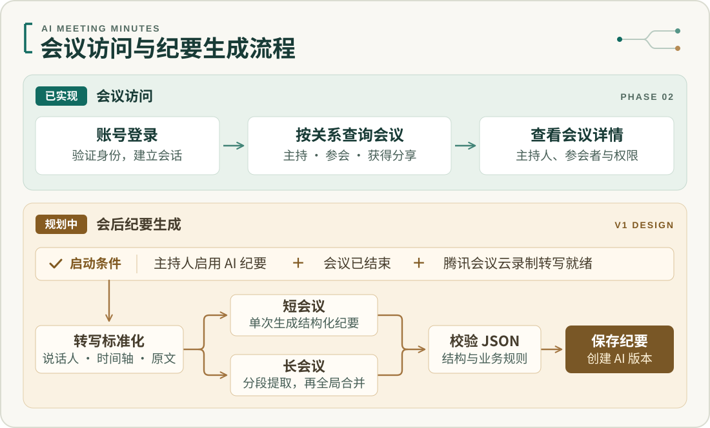
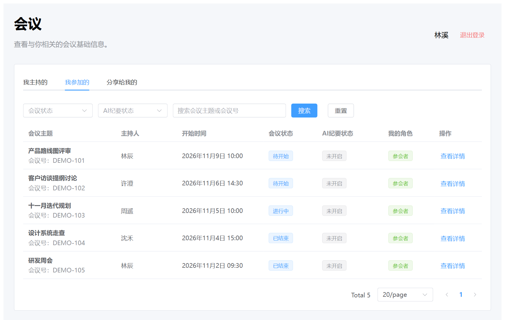
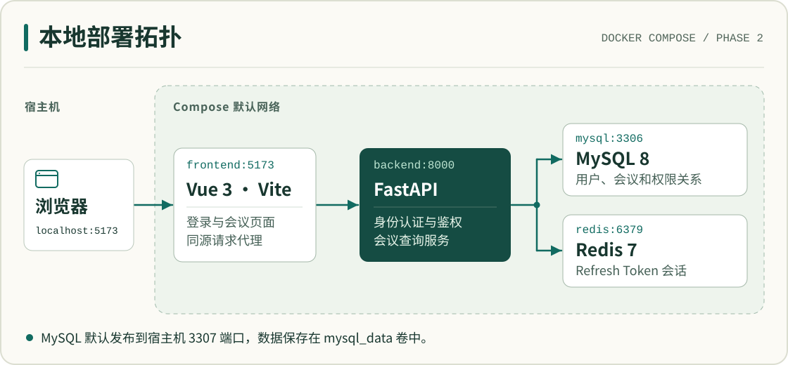

# AI 智能会议纪要系统

公司内部的会议工作台。员工登录后，可以找回自己主持、参加或获授权的会议，按主题或会议号检索，并查看参会者。项目的下一步是接入腾讯会议云录制转写，让会后纪要里的决策和行动项有据可查。

**当前可用版本为 Phase 2。** 认证、会议查询和权限控制已通过独立环境验收。验收基线为 `7daa75e`，后端 32 项、前端 27 项自动化测试通过，另有真实浏览器与依赖故障恢复验证。[Phase 2 Final 确认报告](docs/require/Phase2_Final_确认报告.md)

## 项目工作流程



在当前版本，主持、实际参会和主动授权这三种关系决定普通员工能看哪些会议。管理员还可切换到「全部」查看公司会议，两种角色都由后端校验权限。

在 V1 设计中，主持人明确开启 AI 纪要、会议结束且云录制转写就绪后，后台才会启动生成。短会议直接提取，长会议按完整发言片段切分后汇总。通过校验的决策和行动项会写入新的纪要版本，人工编辑保留原始 AI 版本。

## 会议工作台



*当前 Vue 页面实拍，会议和用户均为虚构演示数据。*

选择会议范围后，可叠加会议状态、纪要状态和关键词筛选。查询条件和页码保存在 URL 中，刷新后可回到相同视图。点「查看详情」可查看主持人及内外部参会者。

## 本地部署与技术栈



前端采用 Vue 3、TypeScript、Element Plus 和 Pinia。FastAPI 运行于 Python 3.12，使用 Pydantic v2 校验请求，SQLAlchemy 2.x 访问 MySQL 8，Alembic 管理表结构。Redis 7 保存可轮换的刷新会话。以上四个服务构成当前开发环境。[Docker Compose 配置](docker-compose.yml)

### 从零启动

准备好 Git、Docker Desktop 和 Docker Compose v2。在 PowerShell 中执行：

```powershell
git clone https://github.com/Zst2001/aimeeting.git
Set-Location aimeeting
Copy-Item .env.example .env
```

在本地 `.env` 中设置独立的 `JWT_SECRET_KEY`、`DATABASE_PASSWORD` 和 `MYSQL_ROOT_PASSWORD`。腾讯会议和百炼凭据可留空。[环境变量模板](.env.example)

```powershell
docker compose up -d --build
docker compose ps
Invoke-RestMethod http://localhost:8000/ready
```

首次启动时等待 MySQL 初始化。等 `/ready` 返回 `ready`，再建表并按提示创建首个管理员。密码通过交互输入，以 Argon2id 哈希保存。

```powershell
docker compose exec backend alembic upgrade head
docker compose exec backend alembic current
docker compose exec backend python -m app.scripts.create_admin
```

打开 [登录页](http://localhost:5173/login) 使用新账号进入工作台。当前迁移应为 `0003_create_meeting_permissions (head)`。全新数据库首次登录会显示空列表，截图中的样例仅用于文档展示。

| 本地入口 | 用途 |
| --- | --- |
| [会议工作台](http://localhost:5173/meetings) | 登录后浏览会议 |
| [API 文档](http://localhost:8000/docs) | 查看请求参数、响应和认证方式 |
| [存活检查](http://localhost:8000/health) | 检查 API 进程是否存活 |
| [就绪检查](http://localhost:8000/ready) | 检查 MySQL 和 Redis，依赖故障时返回 HTTP 503 |

宿主机默认通过 `3307` 访问 MySQL，通过 `6379` 访问 Redis。MySQL 宿主机端口可用 `MYSQL_HOST_PORT` 调整。结束本地运行时使用 `docker compose down` 保留 MySQL 数据卷。

## 接口速查

| 方法与路径 | 行为 |
| --- | --- |
| `POST /api/v1/auth/login` | 校验账号密码，返回用户信息和 Access / Refresh Token |
| `POST /api/v1/auth/refresh` | 轮换令牌，原 Refresh Token 即刻失效 |
| `POST /api/v1/auth/logout` | 以 Access Token 认证并提交 Refresh Token，撤销对应会话 |
| `GET /api/v1/me` | 获取当前登录用户 |
| `GET /api/v1/meetings` | 按范围、状态、关键词和分页查询，默认范围为 `hosted` |
| `GET /api/v1/meetings/{meeting_id}` | 返回会议详情、参会者和当前用户的权限 |

例如，登录后携带 `Authorization: Bearer <access_token>` 请求 `GET /api/v1/meetings?scope=joined&meeting_status=ENDED&page=1&page_size=20`，即可获取本人参加过的已结束会议。

Access Token 默认有效 30 分钟，Refresh Token 默认有效 7 天，可在 `.env` 中调整。前端用 `localStorage` 恢复会话，遇到多个并发 401 时共用一次刷新，再重试原请求。登出会撤销刷新会话，已签发的 Access Token 按原到期时间失效。

## 运行测试

后端集成测试使用真实 MySQL 和 Redis。请指向专用测试实例，先完成迁移，并保持会议表为空。若测试实例使用 Compose 默认宿主机端口，在仓库根目录运行：

```powershell
Set-Location backend
py -3.12 -m venv .venv
.\.venv\Scripts\python -m pip install -e ".[dev]"
$env:DATABASE_HOST = "127.0.0.1"
$env:DATABASE_PORT = "3307"
$env:REDIS_URL = "redis://127.0.0.1:6379/0"
.\.venv\Scripts\python -m pytest
```

前端使用 Node.js 22。从仓库根目录运行：

```powershell
Set-Location frontend
npm ci
npm test
npm run typecheck
npm run build
```

## 设计与交接

- 产品范围与系统实现见 [产品需求](docs/AI智能会议纪要系统_PRD_v1.0.md) 和 [技术设计](docs/AI智能会议纪要系统_SPEC_v1.0.md)。
- 表关系与接口合约见 [数据库设计](docs/DATABASE.md) 和 [API 设计](docs/API.md)。
- 后续集成以 [腾讯会议接入](docs/TENCENT_MEETING.md) 和 [LLM 处理流程](docs/LLM_PIPELINE.md) 为依据。
- 接手开发时可从 [Phase 2 交接摘要](docs/require/Phase2_完成后对话交接.md) 进入各阶段确认报告。
